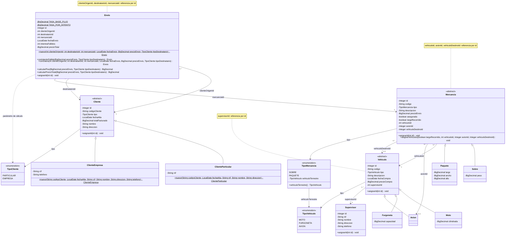
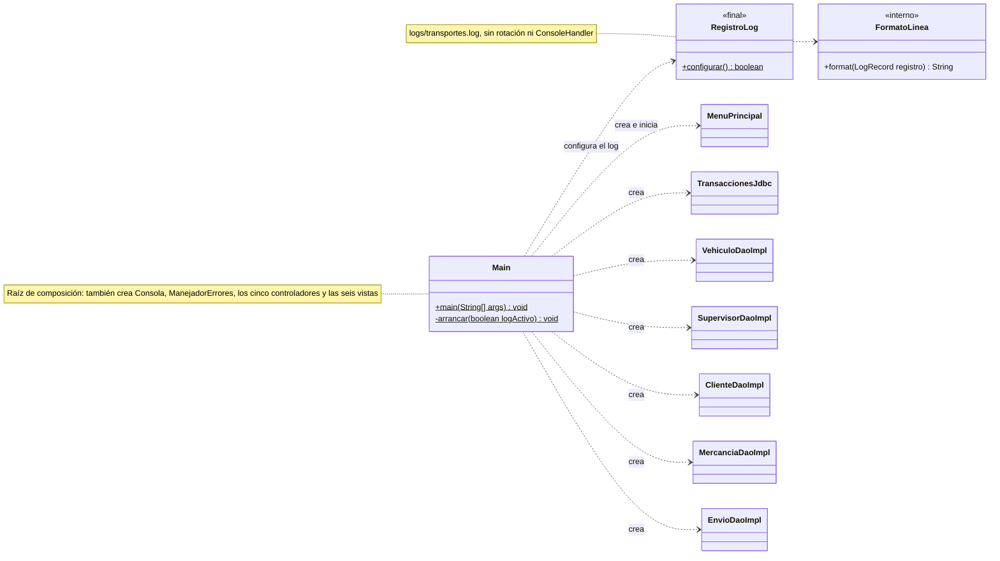

# Diagrama de clases

Generado a partir del código de `src/main/java/com/transportes`. Como un único diagrama sería
ilegible, hay uno por capa:

1. [Entidades y jerarquías](#diagrama-1--entidades-y-jerarquías-model) (`model`)
2. [Excepciones](#diagrama-2--excepciones-exception) (`exception`)
3. [Acceso a datos](#diagrama-3--acceso-a-datos-modeldao-y-config) (`model.dao` y `config`)
4. [Controladores](#diagrama-4--controladores-controller) (`controller`)
5. [Vista](#diagrama-5--vista-view) (`view`)
6. [Arranque](#diagrama-6--arranque-main) (`Main`)

Convenciones:
- `-` privado, `+` público, `#` protegido, `~` interno del paquete, `$` estático.
- Se omiten getters, setters triviales y constructores, salvo en las excepciones.
- **Referencia por id.** Ninguna entidad guarda referencias a otros objetos de dominio, sino el `id`
  (`int` o `Integer`) de la entidad relacionada. Por eso las asociaciones entre entidades se dibujan
  con `-->`, desde la clase que guarda el id, y llevan como etiqueta el nombre de ese campo. No hay
  composición ni agregación entre entidades.
- En las capas `dao`, `controller` y `view`, `-->` indica un campo (dependencia que la clase recibe
  en su constructor) y `..>` un uso sin campo.

## Diagrama 1 · Entidades y jerarquías (`model`)



Cómo leer las multiplicidades:
- **`1..*` en Supervisor:** cada supervisor debe tener al menos un vehículo (RF-13). En el código
  solo se ve que `supervisorId` es obligatorio; el mínimo de uno lo garantiza el controlador.
- **`0..1` en Envio–Mercancia:** viene del UNIQUE sobre `envio.mercancia_id` (P-06).
- **`avionId` y `vehiculoDestinoId`:** su multiplicidad `0..1` depende de `largoRecorrido`.
- **La flecha a `Avion`** expresa la intención de RF-25. En el código, `avionId` es un `Integer`
  cualquiera; el tipo lo comprueban `MercanciaController` y el procedimiento `sp_validar_mercancia`.
- **`TipoMercancia.vehiculoTerrestre`:** SOBRE → MOTO, PAQUETE → FURGONETA. `sp_validar_mercancia`
  (en `sql/schema.sql`) replica esta correspondencia.

### Reglas que hace cumplir el modelo

Cuando un dato no cumple una regla, el modelo lanza `DatoInvalidoException`, salvo que se indique otra excepción.

- **Datos obligatorios.** Los textos obligatorios no pueden ser nulos ni vacíos. Se recortan los
  espacios y se comprueba la longitud máxima de cada columna (código 20, NIF/CIF 20, nombre 100,
  descripción y dirección 200, teléfono 15). Lo hace la clase interna del paquete `Validacion`, que
  no aparece en el diagrama.
- **Importes.** `precioCompra`, `precioEnvio`, `totalFacturado` y `precioTotal` deben ser ≥ 0, se
  normalizan a escala 2 con `HALF_UP` y no pueden superar el máximo de su columna `DECIMAL`.
- **Medidas.** `cilindrada`, `capacidad`, `peso`, `largo`, `ancho` y `alto` deben ser > 0 y caber
  en su columna `DECIMAL`.
- **Identificadores.** Los ids y las referencias por id deben ser > 0. `intentosFallidos` debe ser ≥ 0.
- **El tipo no cambia.** `tipo` es `final` y lo fija el constructor de cada subclase.
- **Otros campos que no cambian.** También son `final`:
  - `codigo` y `codigoCliente`;
  - `fechaAlta` y `totalFacturado` de `Cliente`;
  - todos los campos de `Supervisor` y de `Envio`, salvo `id`. Para modificarlos se crea un objeto
    nuevo con el mismo id (`Envio.conDatos`, `Envio.conIntentoFallido` o un `new Supervisor(...)`).
- **Clientes nuevos.** `ClienteParticular.nuevo` y `ClienteEmpresa.nuevo` crean el cliente sin id y
  con total facturado 0 (RF-14, RF-17).
- **Asignación del id.** `asignarId` solo se puede llamar una vez. Si se llama otra vez, lanza
  `IllegalStateException`, que no es una excepción de dominio.
- **Largo recorrido (RF-23/RF-24).** `asignarVehiculos` exige avión y vehículo de destino si la
  mercancía es de largo recorrido, y que no haya ninguno de los dos si no lo es. Si no se cumple,
  lanza `ReglaAsignacionException`.
- **Origen y destinatario.** En `Envio`, el cliente origen debe ser distinto del destinatario.
- **Plus y precio total (RF-31/RF-32).**
  - Plus = `precioEnvio × (0.04 + 0.01 × intentosFallidos)`, con escala 2 y `HALF_UP`.
  - El plus vale `0.00` si el destinatario no es `PARTICULAR`.
  - Precio total = `precioEnvio + plus`.
- **Intentos fallidos (RF-30/RF-33).** `conIntentoFallido` devuelve un envío nuevo con un intento
  más y el precio recalculado; solo se permite si el destinatario es `PARTICULAR`. `conDatos`
  conserva los intentos y rechaza un destinatario `EMPRESA` si el envío ya tiene alguno.
- **Igualdad (`equals`/`hashCode`).**
  - Por `codigo` en `Vehiculo` y `Mercancia`, y por `codigoCliente` en `Cliente`. En las tres es `final`.
  - Por `nif` en `Supervisor`.
  - Por `id` en `Envio`. Un envío sin id solo es igual a sí mismo.

### Reglas que quedan para el controlador o la BD

| Regla | Dónde |
|---|---|
| Sobre → moto, paquete → furgoneta, también en el vehículo de destino (RF-21/RF-24) | `MercanciaController` + triggers `trg_mercancia_bi/bu` (`sp_validar_mercancia`) |
| `avionId` debe apuntar a un `AVION` (RF-25) | `MercanciaController` + triggers `trg_mercancia_bi/bu` |
| Supervisor con al menos un vehículo; alta conjunta en transacción (RF-13, P-01) | `SupervisorController.registrar`; `VehiculoController` (`UltimoVehiculoException`) |
| No eliminar un vehículo con mercancías (RF-06) | `VehiculoController` (`VehiculoEnUsoException`) + FK RESTRICT |
| No eliminar un supervisor con vehículos (RF-11) | `SupervisorController` (`SupervisorConVehiculosException`) + FK RESTRICT |
| No eliminar un cliente que figure en algún envío (RF-16) | `ClienteController` (`ClienteConEnviosException`) + FK RESTRICT |
| No modificar `precioEnvio` si la mercancía ya tiene envío (RF-26) | `MercanciaController` (`MercanciaConEnvioException`) |
| Actualizar `totalFacturado` al crear, modificar o eliminar envíos y al registrar intentos (RF-17) | `EnvioController` + `UPDATE` incremental en BD, en la misma transacción |
| Número de aviones por supervisor (RF-10) | `FichaSupervisor.numeroAviones()`; también `SupervisorController.contarAviones` |
| Que existan las entidades referenciadas por id | Controlador (`EntidadNoEncontradaException`) + FK en BD |
| Unicidad de códigos, NIF/CIF y `mercancia_id` | UNIQUE en BD (`RegistroDuplicadoException`) |
| Envío a empresa sin intentos fallidos (RF-30) | `Envio.conIntentoFallido` / `conDatos` + triggers `trg_envio_bi/bu` (el constructor de `Envio` no lo impide) |
| El tipo de un vehículo o de un cliente no cambia en BD | Triggers `trg_vehiculo_tipo_bu` y `trg_cliente_tipo_bu`; controladores |

## Diagrama 2 · Excepciones (`exception`)

```mermaid
classDiagram
    direction TB

    class RuntimeException
    class DomainException {
        +DomainException(String mensaje)
        +DomainException(String mensaje, Throwable causa)
    }
    class DatoInvalidoException {
        +DatoInvalidoException(String mensaje)
    }
    class EntidadNoEncontradaException {
        +EntidadNoEncontradaException(String entidad, Object identificador)
    }
    class RegistroDuplicadoException {
        +RegistroDuplicadoException(String mensaje)
    }
    class ReglaAsignacionException {
        +ReglaAsignacionException(String mensaje)
    }
    class VehiculoEnUsoException {
        +VehiculoEnUsoException(String mensaje)
    }
    class UltimoVehiculoException {
        +UltimoVehiculoException(String mensaje)
    }
    class SupervisorConVehiculosException {
        +SupervisorConVehiculosException(String mensaje)
    }
    class MercanciaConEnvioException {
        +MercanciaConEnvioException(String mensaje)
    }
    class ClienteConEnviosException {
        +ClienteConEnviosException(String mensaje)
    }
    class ConfiguracionException {
        +ConfiguracionException(String mensaje)
        +ConfiguracionException(String mensaje, Throwable causa)
    }
    class AccesoDatosException {
        +AccesoDatosException(String mensaje, Throwable causa)
    }

    RuntimeException <|-- DomainException
    DomainException <|-- DatoInvalidoException
    DomainException <|-- EntidadNoEncontradaException
    DomainException <|-- RegistroDuplicadoException
    DomainException <|-- ReglaAsignacionException
    DomainException <|-- VehiculoEnUsoException
    DomainException <|-- UltimoVehiculoException
    DomainException <|-- SupervisorConVehiculosException
    DomainException <|-- MercanciaConEnvioException
    DomainException <|-- ClienteConEnviosException
    RuntimeException <|-- ConfiguracionException
    RuntimeException <|-- AccesoDatosException

    note for ConfiguracionException "Infraestructura: no es de dominio"
    note for AccesoDatosException "Infraestructura: mensaje genérico, detalle al log"
```



Las dos excepciones propias de la vista, `OperacionCancelada` y `FinDeEntrada`, están en el
[diagrama 5](#diagrama-5--vista-view).

### Quién lanza cada excepción

- **El modelo:**
  - `DatoInvalidoException`, en las validaciones de `Validacion`, en origen igual a destinatario,
    en un intento fallido hacia una empresa y en `Envio.conDatos`;
  - `ReglaAsignacionException`, desde `Mercancia.asignarVehiculos`.
- **Los DAO**, a través de `TraductorErroresSql`, a partir del código de error de MySQL:

  | Código | Excepción |
  |---|---|
  | 1062 (duplicado) | `RegistroDuplicadoException`, con el mensaje de la restricción `uq_*` |
  | 3819 (CHECK) | `DatoInvalidoException`, con el mensaje de la restricción `chk_*` |
  | 1644 (SIGNAL de trigger) | `ReglaAsignacionException`, con el mensaje del trigger |
  | 1451 (FK en uso) | `SupervisorConVehiculosException`, `VehiculoEnUsoException`, `MercanciaConEnvioException` o `ClienteConEnviosException` según la FK; `DomainException` genérica si no se reconoce |
  | 1452 (referencia inexistente), 1264 (fuera de rango) | `DatoInvalidoException` |
  | Cualquier otro | `AccesoDatosException` |
- **Los controladores:** `EntidadNoEncontradaException`, `VehiculoEnUsoException` (RF-06),
  `UltimoVehiculoException` (RF-13), `SupervisorConVehiculosException` (RF-11),
  `ClienteConEnviosException` (RF-16), `MercanciaConEnvioException` (RF-26 y mercancía ya enviada),
  `ReglaAsignacionException` (RF-21/RF-24/RF-25) y `DatoInvalidoException` (código o tipo
  modificados, clientes iguales, supervisor de destino igual al eliminado).
- **`TransaccionesJdbc`:** `AccesoDatosException` si falla abrir, confirmar o cerrar la conexión.
- **`ConexionBD`:** `ConfiguracionException` si falta la URL, el usuario o la contraseña, o no se
  puede leer `config.properties`.
- **`ManejadorErrores`** (vista) las captura todas: muestra el mensaje de las `DomainException` y un
  mensaje fijo para `ConfiguracionException`, `AccesoDatosException` y cualquier otra `RuntimeException`.

## Diagrama 3 · Acceso a datos (`model.dao` y `config`)

Las sobrecargas que reciben `Connection` usan la conexión de la transacción en curso y nunca la
cierran ni hacen commit o rollback. Cada `*DaoImpl` implementa todos los métodos de su interfaz;
para no repetirlos, en las implementaciones no se listan.

```mermaid
classDiagram
    direction TB

    class VehiculoDao {
        <<interface>>
        +save(Vehiculo) void
        +save(Vehiculo, Connection) void
        +update(Vehiculo) boolean
        +update(Vehiculo, Connection) boolean
        +reasignarSupervisor(int origenId, int destinoId, Connection) int
        +delete(int id) boolean
        +delete(int id, Connection) boolean
        +findById(int id) Optional~Vehiculo~
        +findByCodigo(String codigo) Optional~Vehiculo~
        +findByTipo(TipoVehiculo tipo) List~Vehiculo~
        +findBySupervisor(int supervisorId) List~Vehiculo~
        +findAll() List~Vehiculo~
        +contarPorSupervisor(int supervisorId) int
        +tieneMercancias(int vehiculoId) boolean
    }
    class SupervisorDao {
        <<interface>>
        +save(Supervisor) void
        +save(Supervisor, Connection) void
        +update(Supervisor) boolean
        +update(Supervisor, Connection) boolean
        +delete(int id) boolean
        +delete(int id, Connection) boolean
        +findById(int id) Optional~Supervisor~
        +findByNif(String nif) Optional~Supervisor~
        +findAll() List~Supervisor~
        +contarAviones(int supervisorId) int
    }
    class ClienteDao {
        <<interface>>
        +save(Cliente) void
        +save(Cliente, Connection) void
        +update(Cliente) boolean
        +update(Cliente, Connection) boolean
        +delete(int id) boolean
        +delete(int id, Connection) boolean
        +findById(int id) Optional~Cliente~
        +findByCodigo(String codigoCliente) Optional~Cliente~
        +findAll() List~Cliente~
        +sumarTotalFacturado(int clienteId, BigDecimal delta) boolean
        +sumarTotalFacturado(int clienteId, BigDecimal delta, Connection) boolean
        +tieneEnvios(int clienteId) boolean
    }
    class MercanciaDao {
        <<interface>>
        +save(Mercancia) void
        +save(Mercancia, Connection) void
        +update(Mercancia) boolean
        +update(Mercancia, Connection) boolean
        +delete(int id) boolean
        +delete(int id, Connection) boolean
        +findById(int id) Optional~Mercancia~
        +findByCodigo(String codigo) Optional~Mercancia~
        +findByVehiculo(int vehiculoId) List~Mercancia~
        +findLargoRecorrido() List~Mercancia~
        +findAll() List~Mercancia~
        +tieneEnvio(int mercanciaId) boolean
    }
    class EnvioDao {
        <<interface>>
        +save(Envio) void
        +save(Envio, Connection) void
        +update(Envio) boolean
        +update(Envio, Connection) boolean
        +delete(int id) boolean
        +delete(int id, Connection) boolean
        +findById(int id) Optional~Envio~
        +findById(int id, Connection) Optional~Envio~
        +findByCliente(int clienteOrigenId) List~Envio~
        +findAll() List~Envio~
        +actualizarIntentos(Envio) boolean
        +actualizarIntentos(Envio, Connection) boolean
    }

    class VehiculoDaoImpl
    class SupervisorDaoImpl
    class ClienteDaoImpl
    class MercanciaDaoImpl
    class EnvioDaoImpl

    class SoporteJdbc {
        <<interno>>
        ~conConexionPropia(String operacion, Operacion~T~ accion)$ T
        ~conConexionExterna(Connection, String operacion, Operacion~T~ accion)$ T
        ~insertar(Connection, String sql, Parametros)$ int
        ~modificar(Connection, String sql, Parametros)$ int
        ~buscarUno(Connection, String sql, Parametros, Mapeador~T~)$ Optional~T~
        ~buscarVarios(Connection, String sql, Parametros, Mapeador~T~)$ List~T~
        ~consultarEntero(Connection, String sql, Parametros)$ int
    }
    class TraductorErroresSql {
        <<interno>>
        ~traducir(SQLException e, String operacion)$ RuntimeException
    }
    class ConexionBD {
        -Configuracion configuracion
        +getConnection()$ Connection
    }

    VehiculoDao <|.. VehiculoDaoImpl
    SupervisorDao <|.. SupervisorDaoImpl
    ClienteDao <|.. ClienteDaoImpl
    MercanciaDao <|.. MercanciaDaoImpl
    EnvioDao <|.. EnvioDaoImpl

    VehiculoDaoImpl ..> SoporteJdbc
    SupervisorDaoImpl ..> SoporteJdbc
    ClienteDaoImpl ..> SoporteJdbc
    MercanciaDaoImpl ..> SoporteJdbc
    EnvioDaoImpl ..> SoporteJdbc
    SoporteJdbc ..> ConexionBD : conexión propia
    SoporteJdbc ..> TraductorErroresSql : SQLException

    note for SoporteJdbc "PreparedStatement y try-with-resources en todas las plantillas"
    note for ConexionBD "Variables de entorno DB_URL, DB_USUARIO, DB_PASSWORD o config.properties"
```



- `SoporteJdbc` declara además tres interfaces funcionales internas (`Operacion`, `Parametros`,
  `Mapeador`) y utilidades para parámetros y columnas opcionales; no se dibujan.
- `ConexionBD` guarda la configuración solo cuando están los tres valores. Sus colaboradores
  (entorno, archivo y `Conector`) se inyectan por un constructor interno del paquete, para los tests.
- `RegistroLog` (también en `config`) aparece en el [diagrama 6](#diagrama-6--arranque-main).

## Diagrama 4 · Controladores (`controller`)

```mermaid
classDiagram
    direction TB

    class Transacciones {
        <<interface>>
        +ejecutar(TrabajoTransaccional~T~ trabajo) T
    }
    class TrabajoTransaccional~T~ {
        <<interface>>
        +ejecutar(Connection conexion) T
    }
    class TransaccionesJdbc {
        +ejecutar(TrabajoTransaccional~T~ trabajo) T
    }

    class VehiculoController {
        +registrar(Vehiculo) Vehiculo
        +modificar(Vehiculo) void
        +eliminar(int id) void
        +buscarPorId(int id) Vehiculo
        +buscarPorCodigo(String codigo) Vehiculo
        +listarPorTipo(TipoVehiculo tipo) List~Vehiculo~
        +listarTodos() List~Vehiculo~
    }
    class SupervisorController {
        +registrar(Supervisor, IntFunction~Vehiculo~ primerVehiculo) FichaSupervisor
        +modificar(Supervisor) void
        +eliminar(int id) void
        +eliminarTraspasandoVehiculos(int id, int supervisorDestinoId) int
        +buscarPorId(int id) Supervisor
        +buscarPorNif(String nif) Supervisor
        +consultar(int id) FichaSupervisor
        +listar() List~FichaSupervisor~
        +contarAviones(int id) int
    }
    class ClienteController {
        -Clock reloj
        +registrarParticular(String codigoCliente, String nif, String nombre, String direccion) ClienteParticular
        +registrarEmpresa(String codigoCliente, String cif, String nombre, String direccion, String telefono) ClienteEmpresa
        +modificar(Cliente) void
        +eliminar(int id) void
        +buscarPorId(int id) Cliente
        +buscarPorCodigo(String codigoCliente) Cliente
        +listarTodos() List~Cliente~
        +historial(int id) HistorialCliente
    }
    class MercanciaController {
        +registrar(Mercancia) Mercancia
        +modificar(Mercancia) void
        +eliminar(int id) void
        +buscarPorId(int id) Mercancia
        +buscarPorCodigo(String codigo) Mercancia
        +listarTodos() List~Mercancia~
        +listarSinEnvio() List~Mercancia~
        +bloqueoPrecioEnvio(int id) Optional~String~
        +listarPorVehiculo(int vehiculoId) List~Mercancia~
        +listarLargoRecorrido() List~Mercancia~
    }
    class EnvioController {
        +crear(int clienteOrigenId, int destinatarioId, int mercanciaId, LocalDate fechaEnvio) Envio
        +modificar(int id, int clienteOrigenId, int destinatarioId, int mercanciaId, LocalDate fechaEnvio) Envio
        +eliminar(int id) void
        +registrarIntentoFallido(int id) Envio
        +buscarPorId(int id) Envio
        +listarTodos() List~Envio~
        +desglose(Envio) DesgloseEnvio
    }

    class FichaSupervisor {
        <<record>>
        +Supervisor supervisor
        +List~Vehiculo~ vehiculos
        +numeroAviones() int
    }
    class HistorialCliente {
        <<record>>
        +Cliente cliente
        +List~Envio~ envios
        +totalFacturado() BigDecimal
    }
    class DesgloseEnvio {
        <<record>>
        +BigDecimal precioBase
        +BigDecimal plus
        +BigDecimal precioTotal
    }

    <<interface>> VehiculoDao
    <<interface>> SupervisorDao
    <<interface>> ClienteDao
    <<interface>> MercanciaDao
    <<interface>> EnvioDao

    Transacciones <|.. TransaccionesJdbc
    Transacciones ..> TrabajoTransaccional

    VehiculoController --> VehiculoDao
    VehiculoController --> SupervisorDao
    SupervisorController --> SupervisorDao
    SupervisorController --> VehiculoDao
    SupervisorController --> Transacciones
    ClienteController --> ClienteDao
    ClienteController --> EnvioDao
    MercanciaController --> MercanciaDao
    MercanciaController --> VehiculoDao
    EnvioController --> EnvioDao
    EnvioController --> ClienteDao
    EnvioController --> MercanciaDao
    EnvioController --> Transacciones

    SupervisorController ..> FichaSupervisor : crea
    ClienteController ..> HistorialCliente : crea
    EnvioController ..> DesgloseEnvio : crea

    note for TransaccionesJdbc "autoCommit=false; commit o rollback; usa ConexionBD"
```

- Las operaciones que tocan varias filas o tablas van en una sola transacción mediante
  `Transacciones`: `SupervisorController.registrar` (supervisor + primer vehículo),
  `eliminarTraspasandoVehiculos` (traspaso + borrado) y las cuatro escrituras de `EnvioController`
  (envío + `total_facturado` del cliente origen).
- `ClienteController` recibe un `Clock` para fijar la fecha de alta; el constructor de dos
  argumentos usa `Clock.systemDefaultZone()`.
- Los controladores solo dependen de las interfaces `*Dao` y de `Transacciones`. Los tests usan
  implementaciones en memoria de esas mismas interfaces.

## Diagrama 5 · Vista (`view`)

```mermaid
classDiagram
    direction TB

    class MenuPrincipal {
        -List~VistaModulo~ modulos
        +iniciar() void
    }
    class VistaModulo {
        <<abstract>>
        #Consola consola
        -ManejadorErrores manejador
        +titulo() String*
        #opciones() List~Opcion~*
        +abrir() void
    }
    class Opcion {
        <<record>>
        +String texto
        +Runnable accion
    }

    class VehiculoView
    class SupervisorView
    class ClienteView {
        ~mostrarHistorial(Consola, ClienteController, MercanciaController)$ void
    }
    class MercanciaView
    class EnvioView
    class ReportesView

    class FormularioVehiculo {
        <<interno>>
        ~elegirTipo() TipoVehiculo
        ~pedirNuevo(TipoVehiculo tipo) IntFunction~Vehiculo~
        ~pedirModificado(Vehiculo actual, int supervisorId) Vehiculo
        ~resumen(Vehiculo)$ String
    }
    class FormularioMercancia {
        <<interno>>
        ~elegirTipo() TipoMercancia
        ~pedirNueva(TipoMercancia tipo) Mercancia
        ~pedirModificada(Mercancia actual, boolean precioModificable) Mercancia
        ~resumen(Mercancia)$ String
        ~tramos(Mercancia, IntFunction~String~ codigoVehiculo)$ String
    }
    class SelectorVehiculo {
        <<interface>>
        +elegir(String etiqueta, TipoVehiculo tipo, Integer actualId) int
    }

    class Consola {
        +String CANCELAR$
        +elegirOpcion(String titulo, List~String~ opciones, String textoCero) int
        +leerEntero(String etiqueta, int min, int max) int
        +leerDecimal(String etiqueta, Rango rango) BigDecimal
        +leerFecha(String etiqueta) LocalDate
        +leerFechaOHoy(String etiqueta, LocalDate hoy) LocalDate
        +leerTextoNoVacio(String etiqueta) String
        +confirmar(String pregunta) boolean
        +leerTextoOActual(String etiqueta, String actual) String
        +leerDecimalOActual(String etiqueta, Rango rango, BigDecimal actual) BigDecimal
        +leerFechaOActual(String etiqueta, LocalDate actual) LocalDate
        +confirmarOActual(String pregunta, boolean actual) boolean
        +mostrar(String mensaje) void
        +exito(String mensaje) void
        +error(String mensaje) void
    }
    class Rango {
        <<enumeration>>
        NO_NEGATIVO
        POSITIVO
    }
    class ManejadorErrores {
        +ejecutar(Runnable accion) void
    }
    class Formato {
        <<final>>
        +fecha(LocalDate)$ String
        +dinero(BigDecimal)$ String
        +decimal(BigDecimal)$ String
        +siNo(boolean)$ String
    }
    class OperacionCancelada
    class FinDeEntrada
    class RuntimeException

    VistaModulo <|-- VehiculoView
    VistaModulo <|-- SupervisorView
    VistaModulo <|-- ClienteView
    VistaModulo <|-- MercanciaView
    VistaModulo <|-- EnvioView
    VistaModulo <|-- ReportesView
    VistaModulo ..> Opcion
    MenuPrincipal --> "6" VistaModulo
    MenuPrincipal --> Consola
    MenuPrincipal --> ManejadorErrores
    VistaModulo --> Consola
    VistaModulo --> ManejadorErrores
    ManejadorErrores --> Consola
    Consola ..> Rango

    VehiculoView --> FormularioVehiculo
    SupervisorView --> FormularioVehiculo
    MercanciaView --> FormularioMercancia
    FormularioMercancia --> SelectorVehiculo
    ReportesView ..> ClienteView : mostrarHistorial

    RuntimeException <|-- OperacionCancelada
    RuntimeException <|-- FinDeEntrada
    Consola ..> OperacionCancelada : palabra cancelar
    Consola ..> FinDeEntrada : entrada agotada
```



Dependencias de cada vista con los controladores (todas son campos recibidos en el constructor):

| Vista | Controladores |
|---|---|
| `VehiculoView` | `VehiculoController`, `SupervisorController` |
| `SupervisorView` | `SupervisorController` |
| `ClienteView` | `ClienteController`, `MercanciaController` |
| `MercanciaView` | `MercanciaController`, `VehiculoController` |
| `EnvioView` | `EnvioController`, `ClienteController`, `MercanciaController` |
| `ReportesView` | `MercanciaController`, `VehiculoController`, `ClienteController` |

- `Opcion` es el record anidado `VistaModulo.Opcion`; `Rango` es el enum anidado `Consola.Rango`;
  `SelectorVehiculo` es la interfaz anidada `FormularioMercancia.SelectorVehiculo`, que
  `MercanciaView` implementa con su método privado `elegirVehiculo`.
- `MenuPrincipal` y `VistaModulo` ejecutan cada opción dentro de `ManejadorErrores.ejecutar`, que
  deja pasar `FinDeEntrada` para que el menú principal termine.
- Los `switch` de `FormularioVehiculo` y `FormularioMercancia` sobre el tipo no tienen `default`:
  si se añade un tipo nuevo, el compilador obliga a completarlos (RNF-09).

## Diagrama 6 · Arranque (`Main`)



`FormatoLinea` es la clase anidada `RegistroLog.FormatoLinea`: de una excepción adjunta solo escribe
el tipo, nunca su mensaje ni su traza.

## Diferencias detectadas

Diferencias entre el código y `docs/plan.md`. No se ha corregido ninguna.

1. **Conteo de aviones (RF-10).** El plan (§2 y Etapa 5) prevé contar los aviones de cada supervisor
   con una consulta (`SupervisorDao.contarAviones`), expuesta en `SupervisorController.contarAviones`.
   Ambos métodos existen, pero ninguna clase de `src/main` los llama: la vista muestra
   `FichaSupervisor.numeroAviones()`, que cuenta en memoria los vehículos de tipo `AVION` de la ficha.
   El resultado es el mismo.
2. **FK no reconocida en el error 1451.** La tabla de traducción del plan (§4) asigna una excepción
   a cada FK. Para una FK que no esté en esa tabla, `TraductorErroresSql` lanza la base
   `DomainException` con el mensaje "No se puede eliminar el registro porque está en uso.". El plan
   no menciona este caso.
