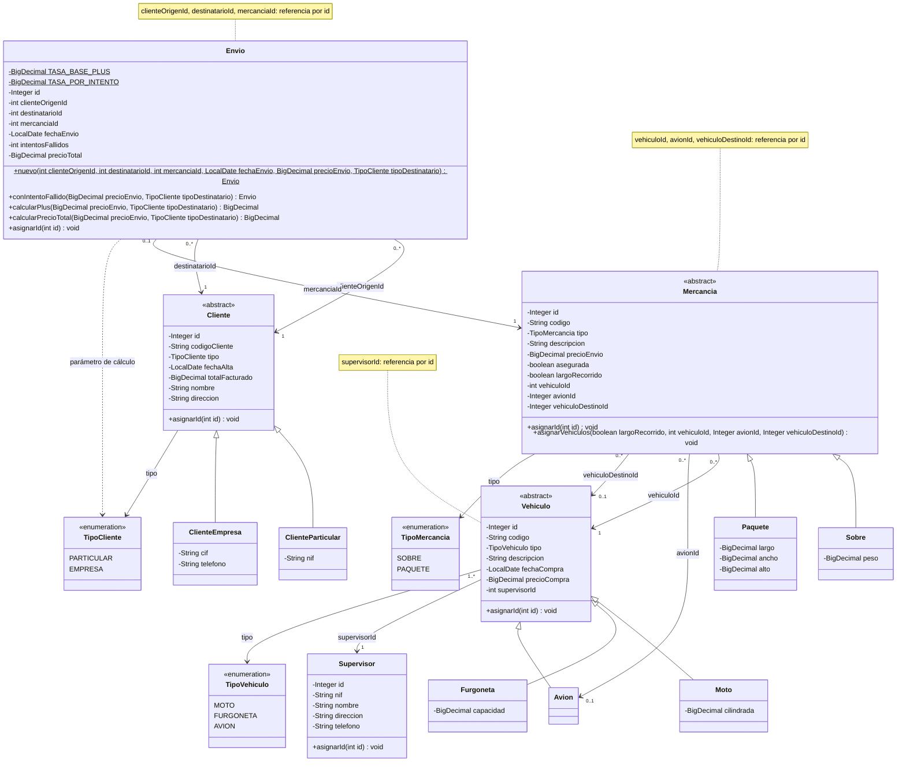
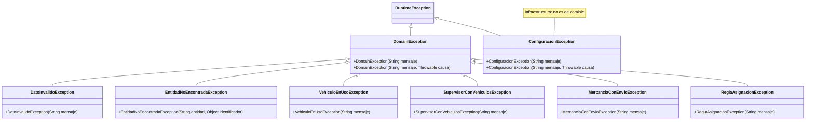

# Diagrama de clases — paquetes `model` y `exception`

Generado a partir del código de `src/main/java/com/transportes/model` y
`src/main/java/com/transportes/exception`. Se omiten getters, setters triviales y constructores
de las entidades.

Convenciones:
- `-` privado, `+` público, `$` estático.
- **Referencia por id.** Ninguna entidad guarda referencias a otros objetos de dominio, sino el `id`
  (`int` o `Integer`) de la entidad relacionada. Por eso las asociaciones se dibujan con `-->`,
  desde la clase que guarda el id, y llevan como etiqueta el nombre de ese campo. No hay
  composición ni agregación en el código.

## Diagrama 1 · Entidades y jerarquías

Cómo leer las multiplicidades:
- **`1..*` en Supervisor:** cada supervisor debe tener al menos un vehículo (RF-13). En el código
  solo se ve que `supervisorId` es obligatorio; el mínimo de uno lo garantiza el controlador.
- **`0..1` en Envio–Mercancia:** viene del UNIQUE sobre `envio.mercancia_id` (P-06).
- **`avionId` y `vehiculoDestinoId`:** su multiplicidad `0..1` depende de `largoRecorrido`.
- **La flecha a `Avion`** expresa la intención de RF-25. En el código, `avionId` es un `Integer` cualquiera.

### Reglas que hace cumplir el modelo

Cuando un dato no cumple una regla, el modelo lanza `DatoInvalidoException`, salvo que se indique otra excepción.

- **Datos obligatorios.** Los textos obligatorios no pueden ser nulos ni vacíos. Se recortan los
  espacios y se comprueba la longitud máxima de cada columna. Lo hace la clase interna del paquete
  `Validacion`, que no aparece en el diagrama.
- **Importes.** `precioCompra`, `precioEnvio`, `totalFacturado` y `precioTotal` deben ser ≥ 0 y se
  normalizan a escala 2 con `HALF_UP`.
- **Medidas.** `cilindrada`, `capacidad`, `peso`, `largo`, `ancho` y `alto` deben ser > 0.
- **Identificadores.** Los ids y las referencias por id deben ser > 0. `intentosFallidos` debe ser ≥ 0.
- **El tipo no cambia.** `tipo` es `final` y lo fija el constructor de cada subclase.
- **Otros campos que no cambian.** También son `final`:
  - `codigo` y `codigoCliente`;
  - `fechaAlta` y `totalFacturado` de `Cliente`;
  - todos los campos de `Supervisor` y de `Envio`, salvo `id`.
- **Asignación del id.** `asignarId` solo se puede llamar una vez. Si se llama otra vez, lanza
  `IllegalStateException`, que no es una excepción de dominio.
- **Largo recorrido (RF-23/RF-24).** `asignarVehiculos` exige avión y vehículo de destino si la
  mercancía es de largo recorrido, y que no haya ninguno de los dos si no lo es. Si no se cumple,
  lanza `ReglaAsignacionException`.
- **Origen y destinatario.** En `Envio`, el cliente origen debe ser distinto del destinatario.
- **Plus y precio total (RF-31/RF-32).**
  - Plus = `precioEnvio × (0.04 + 0.01 × intentosFallidos)`, con escala 2 y `HALF_UP`.
  - El plus vale `0.00` si el destinatario no es `PARTICULAR`.
  - Precio total = `precioEnvio + plus`.
- **Intentos fallidos (RF-33).** `conIntentoFallido` devuelve un envío nuevo con un intento más y
  el precio recalculado. Solo se permite si el destinatario es `PARTICULAR`.
- **Igualdad (`equals`/`hashCode`).**
  - Por `codigo` en `Vehiculo` y `Mercancia`, y por `codigoCliente` en `Cliente`. En las tres es `final`.
  - Por `nif` en `Supervisor`.
  - Por `id` en `Envio`. Un envío sin id solo es igual a sí mismo.

### Reglas que quedan para el controlador o la BD

| Regla | Dónde |
|---|---|
| Sobre → moto, paquete → furgoneta, también en el vehículo de destino (RF-21/RF-24) | Triggers `trg_mercancia_bi/bu` + controlador |
| `avionId` debe apuntar a un `AVION` (RF-25) | Triggers `trg_mercancia_bi/bu` + controlador |
| Supervisor con al menos un vehículo; alta conjunta en transacción (RF-13, P-01) | Controlador |
| No eliminar un vehículo con mercancías o envíos (RF-06) | Controlador (`VehiculoEnUsoException`) + FK RESTRICT |
| No eliminar un supervisor con vehículos (RF-11) | Controlador (`SupervisorConVehiculosException`) + FK RESTRICT |
| No modificar `precioEnvio` si la mercancía ya tiene envío (RF-26) | Controlador (`MercanciaConEnvioException`) |
| Actualizar `totalFacturado` al crear, modificar o eliminar envíos (RF-17) | Controlador + `UPDATE` incremental en BD |
| Número de aviones por supervisor (RF-10) | Consulta en DAO/controlador |
| Que existan las entidades referenciadas por id | FK en BD; controlador (`EntidadNoEncontradaException`) |
| Unicidad de códigos, NIF/CIF y `mercancia_id` | UNIQUE en BD |
| No crear con el constructor un envío con `intentosFallidos > 0` hacia una empresa (RF-30) | Controlador (el constructor no lo impide) |
| El tipo de un vehículo no cambia en BD | Trigger `trg_vehiculo_tipo_bu` |

## Diagrama 2 · Excepciones

### Qué excepciones lanza el modelo y cuáles el controlador

- **Las lanza el modelo:**
  - `DatoInvalidoException`, en todas las validaciones de invariantes de `Validacion`, en origen
    igual a destinatario y en un intento fallido hacia una empresa;
  - `ReglaAsignacionException`, desde `Mercancia.asignarVehiculos`.
- **Las lanzará el controlador** (todavía no se usan en ningún sitio):
  - `EntidadNoEncontradaException`;
  - `VehiculoEnUsoException` (RF-06);
  - `SupervisorConVehiculosException` (RF-11);
  - `MercanciaConEnvioException` (RF-26);
  - `ReglaAsignacionException`, para RF-21/RF-25 tras consultar el tipo de vehículo.
- **Fuera del dominio:** `ConfiguracionException` la lanza la capa `config`. Como hereda de
  `RuntimeException` y no de `DomainException`, la vista tendrá que capturarla por separado.

## Diferencias detectadas

Diferencias entre el código y `docs/plan.md`. No se ha corregido ninguna.

1. **Excepciones fuera del plan.** `DatoInvalidoException` no aparece en el plan (§4). Tampoco
   aparece `ConfiguracionException`, que además hereda de `RuntimeException` y no de `DomainException`.
2. **Clase fuera del plan.** `Validacion` es una clase interna del paquete `model` y no está en la estructura del plan (§4).
3. **Dónde se calcula el plus.** Según el plan (§2, tabla del controlador, y etapa 5), el cálculo
   del plus y del precio total y el recálculo por intento fallido corresponden a `EnvioController`.
   En el código están en `Envio`: `calcularPlus`, `calcularPrecioTotal`, `nuevo` y `conIntentoFallido`.
   El plan además lo llama `plusAlmacenaje`; en el código es `calcularPlus`.
4. **Fecha de alta por defecto.** P-07 indica que `fecha_alta` toma la fecha actual por defecto. El
   constructor de `Cliente` la exige no nula y no aplica ningún valor por defecto, así que el valor
   tendrá que ponerlo la vista o el controlador.
5. **Teléfono de empresa.** En el plan, `cliente.telefono` admite NULL y el CHECK de subtipo no lo
   exige para EMPRESA. En `ClienteEmpresa`, `telefono` es obligatorio.
6. **Precisión de los decimales.**
   - El plan define una precisión y escala por columna: `cilindrada DECIMAL(8,2)`,
     `capacidad DECIMAL(10,2)`, `peso DECIMAL(10,3)`, dimensiones `DECIMAL(10,2)`, importes `DECIMAL(12,2)/(14,2)`.
   - Para las medidas, el modelo solo exige > 0 y no limita ni la escala ni el número de dígitos.
   - Para los importes, el modelo fija escala 2 pero tampoco limita el número de dígitos.
7. **Atribución de RF en P-09.** P-09 asigna RF-23/RF-25 al CHECK y RF-21/RF-24 a los triggers. En
   cambio, §2 del plan y el código asignan RF-25 a los triggers y RF-23/RF-24 al CHECK: la
   documentación de `Mercancia.asignarVehiculos` atribuye RF-23/RF-24 al modelo y deja RF-21/RF-25
   a la BD y al controlador. La incoherencia está dentro del propio plan; el código sigue §2.
